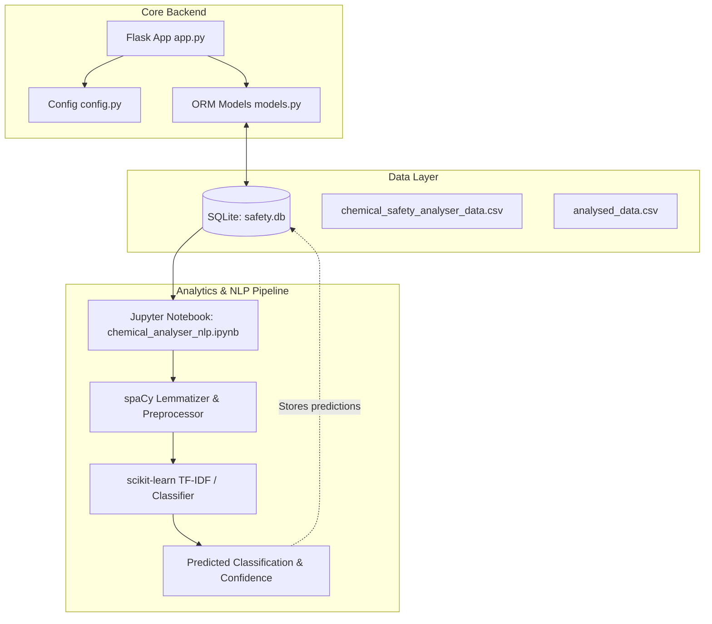
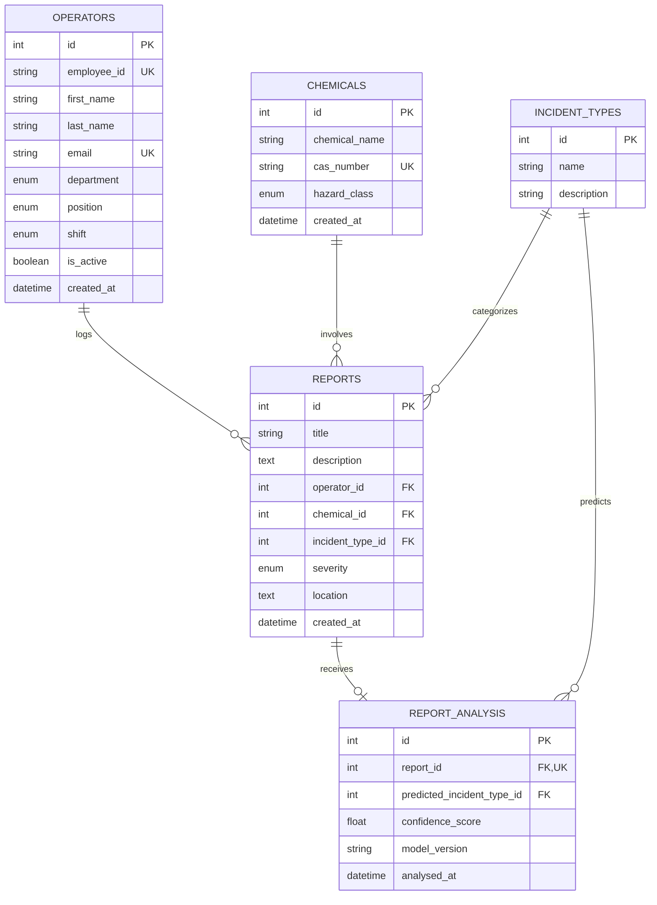

# 🧪 Chemical Safety Analyser

An intelligent industrial chemical safety management and incident classification platform. The system leverages **Flask**, **SQLAlchemy**, and **Natural Language Processing (NLP)** to record, monitor, and automatically classify chemical safety incident reports across plant facilities.

---

## 📌 Table of Contents

- [Overview](#-overview)
- [Key Features](#-key-features)
- [System Architecture](#-system-architecture)
- [Database Schema & Domain Models](#-database-schema--domain-models)
- [NLP & Machine Learning Pipeline](#-nlp--machine-learning-pipeline)
- [Project Directory Structure](#-project-directory-structure)
- [Getting Started](#-getting-started)
  - [Prerequisites](#prerequisites)
  - [Installation](#installation)
  - [Environment Configuration](#environment-configuration)
  - [Database Initialization](#database-initialization)
  - [Running the Application](#running-the-application)
  - [Running the Notebook](#running-the-notebook)
- [Data Dictionary & Taxonomy](#-data-dictionary--taxonomy)
- [Roadmap & Next Steps](#-roadmap--next-steps)

---

## 🔍 Overview

In chemical manufacturing plants, laboratories, and processing facilities, safety incidents must be logged with high accuracy to maintain regulatory compliance (such as OSHA, PSM, and EPA standards) and mitigate hazardous risks. Free-text incident descriptions written by shift operators often vary in terminology, detail, and quality.

The **Chemical Safety Analyser** addresses this challenge by:
1. Providing a relational data model to track **Operators**, **Chemicals**, **Incident Types**, and **Safety Reports**.
2. Storing and analyzing over 3,000 incident reports across diverse plant areas (e.g., Catalyst Regeneration Unit, Distillation Columns, Mixing Vessels).
3. Implementing an NLP pipeline using **spaCy** and **scikit-learn** to preprocess text narratives, standardize chemical units, and automatically predict incident classifications with confidence scoring.

---

## ✨ Key Features

- **Relational Incident Tracking**: Strongly-typed schema connecting operators, chemicals (with CAS numbers), locations, severity levels, and incident categories.
- **Automated Employee Identification**: Automated generation of unique employee identifiers (`EMP-XXXX`).
- **Domain-Specific Text Normalization**: Custom NLP preprocessors that normalize temperature units (`°C` ➔ `celsius`), rectify lemma anomalies (e.g., `datum` ➔ `data`), and filter out non-essential stop words and punctuation.
- **Automated Incident Classification**: Text classification workflow to predict incident categories based on incident log descriptions.
- **Modular Project Structure**: Clean separation of database models, configurations, data science notebooks, and application layers.

---

## 🏛 System Architecture



---

## 🗄 Database Schema & Domain Models

The relational database is built with **Flask-SQLAlchemy** (`models.py`) and backed by **SQLite** (`database/safety.db`).

### Entity Relationship Diagram



### Enumerations
- **`DepartmentType`**: `Production`, `Laboratory`, `Maintenance`, `Quality Assurance`, `Research & Development`, `Utilities`, `Health & Safety`
- **`PositionType`**: `Process Operator`, `Shift Supervisor`, `Safety Officer`, `Laboratory Technician`, `Maintenance Engineer`
- **`ShiftType`**: `Morning`, `Afternoon`, `Night`
- **`SeverityType`**: `Low`, `Medium`, `High`, `Critical`
- **`HazardType`**: `Flammable`, `Corrosive`, `Toxic`, `Oxidizing`, `Reactive`, `Environmental Hazard`

---

## 🧠 NLP & Machine Learning Pipeline

Located in [`notebooks/chemical_analyser_nlp.ipynb`](notebooks/chemical_analyser_nlp.ipynb), the exploratory analysis and machine learning pipeline follows these stages:

1. **Database Extraction**: Direct SQL extraction via `sqlite3` and `pandas` into unified DataFrames.
2. **Exploratory Data Analysis (EDA)**:
   - Word count and distribution analysis of incident descriptions.
   - Missing value and duplicate verification across reports and lookup tables.
   - Frequency analysis of incidents grouped by severity, department, and chemical hazard class.
3. **Text Preprocessing & Normalization**:
   - **spaCy Tokenization & Lemmatization**: Uses `en_core_web_sm` to reduce words to their base linguistic roots.
   - **Chemical & Physical Unit Parsing**: Maps `°C` and variations to `celsius`.
   - **Domain Vocabulary Handling**: Replaces irregular lemmatization outputs (e.g., standardizing `datum` to `data`).
   - **Stopword & Punctuation Filtering**: Strips noisy symbols while preserving vital technical identifiers.
4. **Feature Engineering & Modeling**:
   - Extraction of TF-IDF feature vectors (`TfidfVectorizer`).
   - Train/test splitting with stratified sampling.
   - Multi-class classification across the 10 standard incident categories.

---

## 📂 Project Directory Structure

```plaintext
chemical_safety_analyser/
│
├── app.py                     # Flask application entry point & route definitions
├── config.py                  # Environment and SQLAlchemy configuration
├── models.py                  # Database schema definitions and Enum classes
├── requirements.txt           # Project Python dependencies
├── .env                       # Environment variables (git-ignored)
├── .gitignore                 # Files and directories ignored by Git
│
├── backend/                   # Backend services, API blueprints, and utilities
├── frontend/                  # Web dashboard templates, static assets, or SPA client
│
├── database/
│   └── safety.db              # SQLite relational database instance
│
├── data/
│   ├── chemical_safety_analyser_data.csv   # Combined report records and attributes
│   └── analysed_data.csv                   # Cleaned narrative text paired with target labels
│
└── notebooks/
    └── chemical_analyser_nlp.ipynb         # EDA, NLP preprocessing, and classification model
```

---

## 🚀 Getting Started

### Prerequisites

- **Python 3.10+**
- **pip** package manager

### Installation

1. **Clone the repository**:
   ```bash
   git clone <repository_url>
   cd chemical_safety_analyser
   ```

2. **Create and activate a virtual environment**:
   - **Windows (Command Prompt / PowerShell)**:
     ```powershell
     python -m venv venv
     .\venv\Scripts\activate
     ```
   - **macOS / Linux**:
     ```bash
     python3 -m venv venv
     source venv/bin/activate
     ```

3. **Install dependencies**:
   ```bash
   pip install -r requirements.txt
   ```

4. **Download the spaCy English model**:
   ```bash
   python -m spacy download en_core_web_sm
   ```

### Environment Configuration

Create a `.env` file in the root directory (or edit the existing one):

```env
SECRET_KEY=your_secure_random_key_here
FLASK_ENV=development
```

### Database Initialization

The database tables are automatically verified and created on app startup if they do not exist. To manually trigger creation:

```python
from app import app, db
with app.app_context():
    db.create_all()
    print("Database tables initialized.")
```

### Running the Application

Start the Flask development server:

```bash
python app.py
```

The application will start on port `5500`:
- **URL**: `http://127.0.0.1:5500/`
- **Response**:
  ```json
  {
    "status": "success",
    "message": "Chemical Safety Analyser App"
  }
  ```

### Running the Notebook

To view and execute the exploratory data analysis and NLP modeling:

```bash
jupyter notebook notebooks/chemical_analyser_nlp.ipynb
```

---

## 📊 Data Dictionary & Taxonomy

### Incident Categories

| Category | Description |
| :--- | :--- |
| **Temperature Excursion** | Process temperature exceeded design limits or operating thresholds. |
| **Pressure Failure** | Unexpected pressure spike or loss during vessel/pipeline operation. |
| **Chemical Leak** | Uncontrolled containment loss or discharge of liquid/gas chemicals. |
| **Equipment Failure** | Mechanical or electrical failure (pumps, compressors, motors). |
| **Catalyst Degradation** | Loss of catalytic activity or selectivity impacting yield. |
| **Fire Incident** | Combustion event or open flame sparked by chemicals or equipment. |
| **Corrosion Failure** | Material degradation, surface pitting, or thinning due to aggressive media. |
| **Operator Error** | Procedural deviation, incorrect valve lineup, or interlock bypass. |
| **Instrumentation Failure** | Transmitter drift, erroneous sensor readings, or loop communication loss. |
| **Contamination** | Foreign material or cross-chemical ingress into production streams. |

---

## 🗺 Roadmap & Next Steps

- [ ] **RESTful API Endpoints**: Expose endpoints in `backend/` for creating, searching, and filtering safety reports.
- [ ] **Live NLP Inference Route**: Add `/api/v1/analyze` to accept incident text, run preprocessing, and return predicted incident type with confidence scores.
- [ ] **Interactive Frontend Dashboard**: Build out `frontend/` with incident trends, chemical hazard heatmaps, and severity breakdown charts.
- [ ] **Model Persistence**: Export trained classification models (e.g. `joblib` / `onnx`) for production inference.
- [ ] **Automated Alerting**: Trigger notifications when high or critical severity reports are logged.
