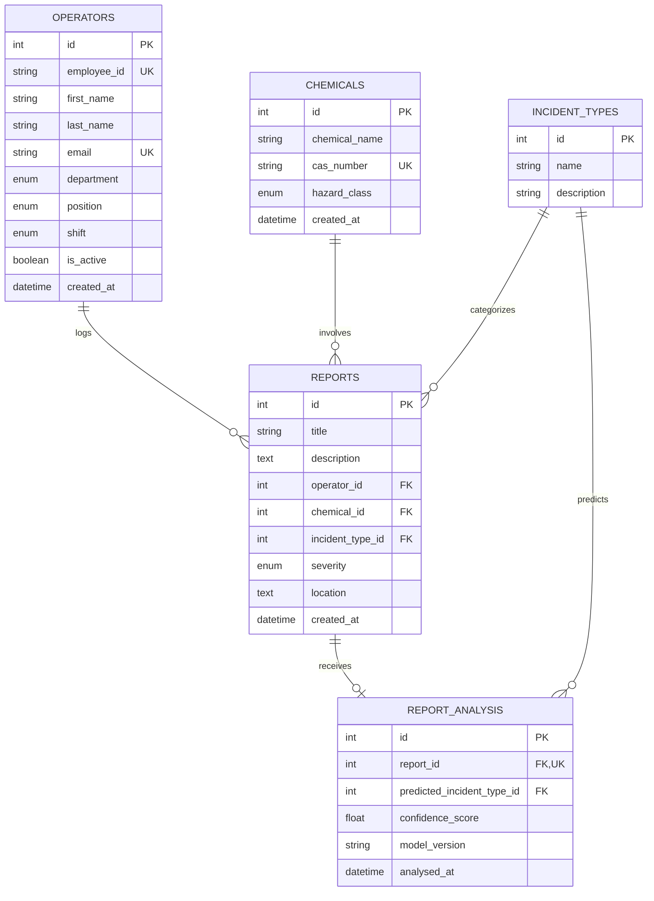

# 🧪 Chemical Safety Analyser

> 🚧 **Project Status: Work in Progress (Active Development)**  
> **Current Focus:** Exploratory Data Analysis (EDA) and NLP text preprocessing inside [`notebooks/chemical_analyser_nlp.ipynb`](notebooks/chemical_analyser_nlp.ipynb).  
> *Note: Database schemas and data generation are completed; machine learning modeling is currently underway in the notebook, and backend API routes and frontend interfaces will be built in subsequent phases.*

---

## 📌 Table of Contents

- [Overview](#-overview)
- [Project Status & Current Stage](#-project-status--current-stage)
- [Key Features](#-key-features)
- [System Architecture](#-system-architecture)
- [Database Schema & Domain Models](#-database-schema--domain-models)
- [NLP & Machine Learning Pipeline](#-nlp--machine-learning-pipeline)
- [Project Directory Structure](#-project-directory-structure)
- [Getting Started](#-getting-started)
  - [Prerequisites](#prerequisites)
  - [Installation](#installation)
  - [Environment Configuration](#environment-configuration)
  - [Running the Notebook (Current Active Focus)](#running-the-notebook-current-active-focus)
  - [Running the Flask App (Base Service)](#running-the-flask-app-base-service)
- [Data Dictionary & Taxonomy](#-data-dictionary--taxonomy)
- [Project Roadmap](#-project-roadmap)

---

## 🔍 Overview

In chemical manufacturing plants, laboratories, and processing facilities, safety incidents must be logged with high accuracy to maintain regulatory compliance (such as OSHA, PSM, and EPA standards) and mitigate hazardous risks. Free-text incident descriptions written by shift operators often vary in terminology, detail, and quality.

The **Chemical Safety Analyser** addresses this challenge by:
1. Providing a relational data model to track **Operators**, **Chemicals**, **Incident Types**, and **Safety Reports**.
2. Storing and analyzing over 3,000 incident reports across diverse plant areas (e.g., Catalyst Regeneration Unit, Distillation Columns, Mixing Vessels).
3. Implementing an NLP pipeline using **spaCy** and **scikit-learn** to preprocess text narratives, standardize chemical units, and automatically predict incident classifications with confidence scoring.

---

## 📍 Project Status & Current Stage

This project is in **active development**, with current work focused entirely on the **data science and NLP exploration phase in Jupyter Notebooks**:

- ✅ **Phase 1: Database Architecture & Data Population (Completed)**
  - Configured relational models in `models.py` ([Operator](models.py), [Chemical](models.py), [IncidentType](models.py), [Report](models.py), [ReportAnalysis](models.py)).
  - Initialized SQLite database `database/safety.db` loaded with 3,000 safety incident records.
- 🔄 **Phase 2: Exploratory Data Analysis & NLP Preprocessing (CURRENT STAGE)**
  - Actively working inside [`notebooks/chemical_analyser_nlp.ipynb`](notebooks/chemical_analyser_nlp.ipynb).
  - Inspecting dataset distributions, checking missing values, analyzing word counts.
  - Applying linguistic processing using `spaCy` (`en_core_web_sm`): tokenization, stop-word filtering, punctuation removal, lemmatization, and chemical temperature normalization (`°C` ➔ `celsius`).

---

## ✨ Key Features

- **Relational Incident Tracking**: Strongly-typed schema connecting operators, chemicals (with CAS numbers), locations, severity levels, and incident categories.
- **Automated Employee Identification**: Automated generation of unique employee identifiers (`EMP-XXXX`).
- **Domain-Specific Text Normalization**: Custom NLP preprocessors that normalize temperature units (`°C` ➔ `celsius`), rectify lemma anomalies (e.g., `datum` ➔ `data`), and filter out non-essential stop words and punctuation.
- **Automated Incident Classification**: Text classification workflow to predict incident categories based on incident log descriptions.
- **Modular Project Structure**: Clean separation of database models, configurations, data science notebooks, and application layers.

---

## 🗄 Database Schema & Domain Models

The relational database is built with **Flask-SQLAlchemy** (`models.py`) and backed by **SQLite** (`database/safety.db`).

### Entity Relationship Diagram

### Enumerations
- **`DepartmentType`**: `Production`, `Laboratory`, `Maintenance`, `Quality Assurance`, `Research & Development`, `Utilities`, `Health & Safety`
- **`PositionType`**: `Process Operator`, `Shift Supervisor`, `Safety Officer`, `Laboratory Technician`, `Maintenance Engineer`
- **`ShiftType`**: `Morning`, `Afternoon`, `Night`
- **`SeverityType`**: `Low`, `Medium`, `High`, `Critical`
- **`HazardType`**: `Flammable`, `Corrosive`, `Toxic`, `Oxidizing`, `Reactive`, `Environmental Hazard`

---

### Incident Categories

| Category | Description |
| :--- | :--- |
| **Temperature Excursion** | Process temperature exceeded design limits or operating thresholds. |
| **Pressure Failure** | Unexpected pressure spike or loss during vessel/pipeline operation. |
| **Chemical Leak** | Uncontrolled containment loss or discharge of liquid/gas chemicals. |
| **Equipment Failure** | Mechanical or electrical failure (pumps, compressors, motors). |
| **Catalyst Degradation** | Loss of catalytic activity or selectivity impacting yield. |
| **Fire Incident** | Combustion event or open flame sparked by chemicals or equipment. |
| **Corrosion Failure** | Material degradation, surface pitting, or thinning due to aggressive media. |
| **Operator Error** | Procedural deviation, incorrect valve lineup, or interlock bypass. |
| **Instrumentation Failure** | Transmitter drift, erroneous sensor readings, or loop communication loss. |
| **Contamination** | Foreign material or cross-chemical ingress into production streams. |

---
